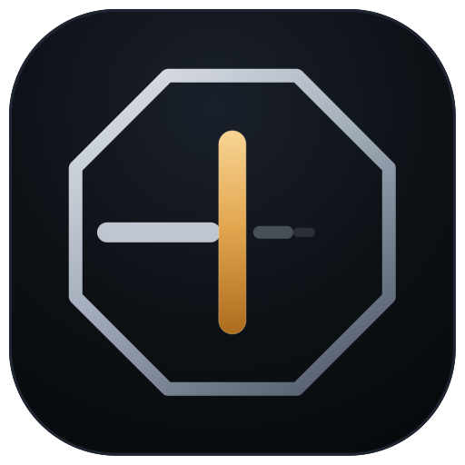
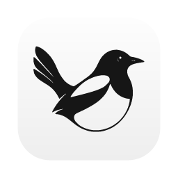

<div align='center'>



# impulse-brake

[简体中文](README.md) | **English**

**Before an AI coding agent rewrites your project, make it offer a plan.**

A lightweight skill and hooks for developers who start fast, change direction, and want to finish what they started.

[](LICENSE)
[](https://github.com/zxbdzh/impulse-brake/actions/workflows/test.yml)
[](https://github.com/zxbdzh/impulse-brake/stargazers)
[](#claude-code)
[](#codex)
[](#pi)
[](#dsh)

</div>

> **Language support:** This README is in English; the bundled skill, reminders, and default prompt triggers are currently in Chinese. An English prompt such as “rewrite everything” does **not** trigger the keyword hook by default. Command checks match command syntax, not your conversation language.

[Demo](#a-30-second-example) · [Install](#install) · [Support](#support-matrix) · [Protocol](#the-brake-protocol) · [Limitations](#known-limitations) · [Disable](#disable-or-uninstall)

## A 30-second example

You type:

```text
这个项目全部重写吧
```

That means “Let's rewrite the entire project.” Instead of immediately replacing the code, the agent offers a structured decision. This is an English translation of a recorded response, not a fixed output template:

```text
1. Scope          Recommended: redesign first, migrate incrementally
                  Alternatives: rebuild everything / rewrite only the agent CLI
2. Existing users Recommended: preserve the released version and existing data
3. Stack          Recommended: keep FastAPI + React
4. Uncommitted    Recommended: commit to a WIP branch before changing direction

Context from that project:
· It was already in use by colleagues.
· ~17,000 backend lines + ~58,000 frontend lines made a full rewrite a multi-week task.
```

**One pause per impulse.** After you have heard the trade-offs and still want to proceed, the skill tells the agent to comply without repeated persuasion. The command-blocking hook is a separate layer and does not accept a conversational override.

## Install

You need the target client. Hook scripts and the Codex/DSH installers also need Node.js on your `PATH`; clone-based routes need Git. The shell examples use Bash/Git Bash syntax.

### Claude Code


```bash
claude plugin marketplace add zxbdzh/impulse-brake
claude plugin install impulse-brake@impulse-brake
```

Inside a session, use `/plugin marketplace add zxbdzh/impulse-brake`, followed by `/plugin install impulse-brake@impulse-brake`. This installs the skill and both hooks.

### Codex


In the tested Codex version, hook commands did not expand plugin-root variables. The installer writes absolute script paths to `~/.codex/hooks.json`:

```bash
git clone https://github.com/zxbdzh/impulse-brake ~/.impulse-brake
node ~/.impulse-brake/hooks/install-codex.mjs
```

Restart Codex and approve the new hooks when prompted. Keep the clone at that path: moving or deleting it breaks the hook commands. If the clone already exists, skip `git clone`.

The installer is intended to replace its own entries while preserving unrelated hooks and backs up an existing configuration. **It replaces invalid JSON after backing it up**; repair an invalid `hooks.json` before installing if you need to preserve its active settings.

To install the skill through the Codex plugin marketplace as well:

```bash
codex plugin marketplace add zxbdzh/impulse-brake
codex plugin add impulse-brake@impulse-brake
```

The plugin alone does not replace the hook installer.

### Pi


```bash
pi install git:github.com/zxbdzh/impulse-brake
```

This package provides the skill only. A Pi hook extension is not included.

### DSH


This integration uses DSH's skill directory and per-turn prompt injection, not a tool-execution hook:

```bash
git clone https://github.com/zxbdzh/impulse-brake ~/.impulse-brake
node ~/.impulse-brake/hooks/install-dsh.mjs
```

Skip the clone command if that directory already exists. The installer copies the skill to `~/.dsh/skills/impulse-brake` and maintains a marked block in `~/.dsh/prompt-inject.md`. Re-running it replaces that block and the installed skill copy; it backs up nonempty prompt-injection content before editing.

The reminder is included every turn, but the model still decides how to respond. **DSH has no command blocking in this integration.**

### magpie gateway (optional alternative)



If your requests already pass through a [magpie](https://usemagpie.ai) gateway, use the middleware instead of client-side prompt reminders. From a local clone:

```bash
cp middleware/impulse-brake.middleware.js ~/.config/magpie/middleware/
magpie plugin add ~/.config/magpie/middleware/impulse-brake.middleware.js
```

The gateway reloads middleware on save. Its checks operate on **user message text**, not commands an agent executes locally. Installing both reminder paths can produce duplicate reminders; middleware alone does not replace `PreToolUse` command blocking.

Client marks belong to their respective owners and identify integrations only. Bundled copies are not an endorsement.

## Support matrix

| Client | Skill | Prompt reminder | Command blocking |
|---|:---:|---|---|
|  Claude Code | Yes | Keyword hook | PreToolUse hook |
|  Codex | Via plugin | Keyword hook | PreToolUse hook, via installer |
|  Pi | Yes | Model-selected skill only | None |
|  DSH | Yes | Every-turn prompt injection | None |
|  magpie gateway | No | Middleware | User text only; not tool calls |

## How it works

| Layer | Purpose | Enforcement |
|---|---|---|
| Skill | Defines the decision protocol | The model must choose to follow it |
| UserPromptSubmit | Appends a reminder when a prompt matches the trigger list | Keyword matching is deterministic; compliance is not |
| PreToolUse | Rejects matching high-risk commands | Client-side hook; client-specific deny behavior |

The hook scripts run locally without a separate model request. Injected reminders and loaded skill text still use context tokens; there is no universal fixed token cost.

## The brake protocol

| Impulse | Alternative action |
|---|---|
| Rewrite everything | Preserve the old implementation. Build a prototype that can run within half a day, compare the same use case, then decide whether to migrate. |
| Switch framework, library, or language | Compare the problem solved, migration cost, and risk. Defer the decision until the next session unless the current technology has a concrete blocking limitation. |
| Add a new idea mid-task | Record it in `docs/decision-log.md` and finish the current task. |
| Abandon the task | Distinguish being blocked from being bored. If bored, finish a minimal usable version with at most three items before deciding what comes next. |

For larger projects, the skill also suggests 1–3 day work cycles that end with something runnable or demonstrable.

## Configuration

Edit trigger words, regex patterns, dangerous-command patterns, and reminder text in [`hooks/lib.mjs`](hooks/lib.mjs). The middleware has its own `DEFAULTS` in [`middleware/impulse-brake.middleware.js`](middleware/impulse-brake.middleware.js); changes to one do not update the other.

A deliberate trade-off: default triggers include `全部重写` (“rewrite everything”), but not the bare word `重写` (“rewrite”). Rewriting a function is normal work, not necessarily a change of project direction. Add and test English patterns if you need deterministic English prompt matching.

Claude Code uses a cached plugin copy. Editing the clone does not edit that installed copy; update or reinstall the plugin to pick up a published change.

`PreToolUse` has **no passphrase override**. Run an intentionally blocked command yourself in a terminal after reviewing its effects. The optional gateway has a different policy: a matching user message can pass after including a configured confirmation phrase, such as `确认执行` or `confirm`. That does not override the client hook.

## Verified behavior

The following results were previously observed on a Windows machine with **Claude Code 2.1** and **Codex 0.165**. They are compatibility observations for those versions, not a guarantee for every future release.

| Client | Scenario | Observed result |
|---|---|---|
| Claude Code 2.1 | `这个项目全部重写吧` | Offered options before beginning a rewrite |
| Claude Code 2.1 | `git reset --hard` | Hook blocked execution |
| Codex 0.165 | `这个项目全部重写吧` | Asked about scope and stack first |
| Codex 0.165 | `git reset --hard` | `hook: PreToolUse Blocked` |
| Both | `rm -rf ./dist` | Allowed; the `rm` pattern targets exact root/home forms |

```bash
npm test    # 15 hook checks + 11 middleware checks
```

Compatibility details behind the implementation:

- Claude Code expands `${CLAUDE_PLUGIN_ROOT}`; the generic `${PLUGIN_ROOT}` did not work in the tested installation.
- Codex hook commands needed absolute paths; plugin-root variables were not expanded.
- The tested Codex client needed exit code **0** plus a JSON permission decision of `deny`; exit code 2 was treated as a hook failure.
- The tested Claude Code client required exit code **2**. The shared script selects the convention using Codex's `turn_id` field.

## Known limitations

- **Chinese-first prompts.** An English README does not add English trigger phrases or translate the bundled skill.
- **A small regex guard, not a security sandbox.** Alternate spellings, argument orders, wrappers, and non-shell tools can evade command checks. Invalid hook input also fails open. Review destructive operations yourself.
- **Different layers see different inputs.** `UserPromptSubmit` sees prompt text; `PreToolUse` sees command fields; the gateway sees request text, not local tool execution.
- **Detection is heuristic.** “Just do it” can miss; a legitimate large refactor can match. A reminder does not guarantee a particular response.
- **Limited client coverage.** Only Claude Code and Codex have bundled tool hooks. Pi is skill-only; DSH is prompt-based. Cursor, Continue, and Aider integrations are not included.

## Disable or uninstall

Disable the layer you do not want rather than removing everything:

| Layer | Action |
|---|---|
| One keyword reminder | Rephrase without a matching trigger; this does not disable command blocking |
| Claude Code plugin | `/plugin disable impulse-brake@impulse-brake` in a session, or `claude plugin uninstall impulse-brake@impulse-brake` |
| Codex hooks | Remove only the two hook entries pointing to this clone from `~/.codex/hooks.json`, preserving other hooks; restart Codex |
| Pi skill package | `pi remove git:github.com/zxbdzh/impulse-brake` |
| DSH reminder | Remove the block between `<!-- impulse-brake:begin -->` and `<!-- impulse-brake:end -->` in `~/.dsh/prompt-inject.md`; the skill remains installed |
| magpie middleware | Disable this middleware in magpie's plugin controls |

To run one blocked command, review it and run it yourself in your terminal. Asking the model to run it again will not grant permission.

## Repository layout

```text
impulse-brake/
├── .claude-plugin/         Claude Code plugin and marketplace manifests
├── .codex-plugin/          Codex plugin manifest
├── hooks/
│   ├── hooks.json         Hook registration
│   ├── install-codex.mjs  Absolute-path hook installer
│   ├── install-dsh.mjs    Skill and prompt-injection installer
│   ├── lib.mjs            Shared hook rules and reminder
│   ├── user-prompt-submit.mjs
│   ├── pre-tool-use.mjs
│   └── test.mjs
├── assets/                Project artwork and client marks
├── skills/impulse-brake/   Decision protocol
└── middleware/            Optional magpie gateway integration
```

## Contributing

- For trigger words or command patterns, edit `hooks/lib.mjs` and add cases to `hooks/test.mjs`. Keep middleware rules and tests consistent when the same change applies there.
- Put new client hook adapters under `hooks/` and document their stdin/stdout contract.
- In an issue, include the client and version, a sanitized prompt or command, expected behavior, and actual behavior. Do not include secrets.

## License

[MIT](LICENSE) © zxbdzh

<div align='center'>
<sub>Finish the project you started. Change direction deliberately.</sub>
</div>
