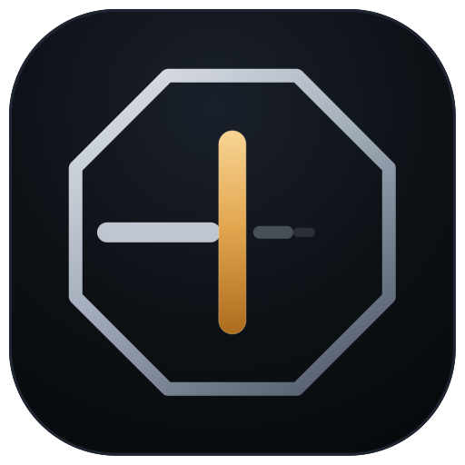
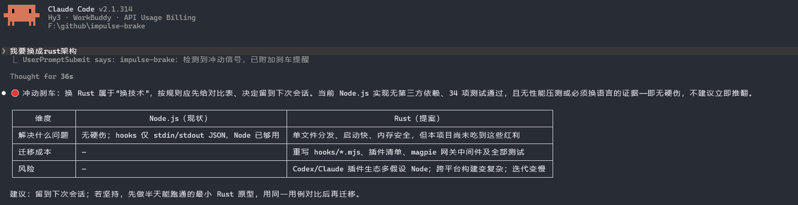
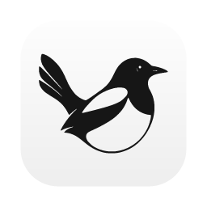

<div align="center">



# impulse-brake

**简体中文** | [English](README.en.md)

**当你在编码会话里说出「全部重写」，AI 先给你一个方案，而不是直接开工。**

一个给「想法多、动手快、也容易中途推翻重来」的人写的刹车。

[](LICENSE)
[](https://github.com/zxbdzh/impulse-brake/actions/workflows/test.yml)
[](https://github.com/zxbdzh/impulse-brake/stargazers)
[](https://github.com/zxbdzh/impulse-brake)
[](https://github.com/zxbdzh/impulse-brake)
[](https://github.com/zxbdzh/impulse-brake)
[](https://github.com/zxbdzh/impulse-brake)

</div>

> **语言范围**：英文使用说明见 [English README](README.en.md)。当前默认触发词、skill 和提醒正文仍以中文为主，英文的 `rewrite everything` 不会自动命中关键词 hook。

---

## 交给 AI 一键安装

把下面这段发给你的 AI 编程助手，让它读取[安装指引](INSTALL.md)，为当前客户端完成安装、备份和验证：

```text
请读取 https://raw.githubusercontent.com/zxbdzh/impulse-brake/master/INSTALL.md ，按其中步骤为我当前使用的客户端安装 impulse-brake 并验证结果。只安装当前客户端，保留已有配置；需要重启或人工授权时明确告诉我。
```

支持 Claude Code / Codex / Pi / DSH；无法可靠判断当前客户端时，AI 会先询问。AI 需要联网读取文件并具备本地命令权限；客户端的信任确认不能跳过。magpie 网关只在你明确要求时安装，避免重复提醒。

## 30 秒看懂



*Claude Code 原生界面实拍：输入「我要换成rust架构」，客户端显示 impulse-brake 触发提醒，再给出换栈成本与风险对比。仅裁切窗口边缘，未重绘或拼接对话。*

<details>
<summary>展开场景与文字摘要</summary>

你正在一个已有 Node.js hooks、客户端插件、安装器和测试的项目里，突然说：

```text
我要换成rust架构
```

本次实跑先给出：

- **为什么换**：目前没有性能压测或必须换语言的证据，先明确要解决的问题。
- **会动到哪里**：hooks、客户端接入、安装分发、网关宿主与测试，都需要逐项评估。
- **替代动作**：留到下次会话再决定；若要验证，先保留现状、做最小 Rust 原型，用同一用例比较。

**演示边界**：截图来自 Claude Code v2.1.314 的真实终端界面，显示模型为 `Hy3 · WorkBuddy`，不是 Anthropic Claude 模型。它恢复了此前 `workbuddy/hy3` 的实跑会话，项目背景由系统提示提供、生成回答时所有工具关闭；本图并非重新发起请求，也不是代码审计或命令拦截实测。保留了客户端标识、用户输入、hook 提醒、表格和建议，只裁去窗口外围与建议后的未执行 `<toolinvoke>` 文本。完整原文及设置见下方记录。模型判断不等于性能实测，提醒不保证每次被遵循。

[完整输出与演示设置](assets/screenshots/rust-switch-session.json) · [截图来源](assets/screenshots/README.md)

</details>

刹车不是为了拦住你，是为了让你在踩油门前多看一眼。**所以每个冲动只刹一次**——你听完还坚持，AI 立刻照办，不重复劝阻。

## 安装

需要先安装对应客户端；hook 和 Codex / DSH 安装器需要 PATH 中可用的 Node.js，克隆仓库需要 Git。以下命令按 Bash / Git Bash 语法书写。

###  Claude Code

```bash
claude plugin marketplace add zxbdzh/impulse-brake
claude plugin install impulse-brake@impulse-brake
```

会话里也行：`/plugin marketplace add zxbdzh/impulse-brake` → `/plugin install impulse-brake@impulse-brake`

一次装好 skill + 两个 hook，不用再配别的。

###  Codex

Codex 的 hook 命令不支持任何变量展开（`${PLUGIN_ROOT}` 会原样丢给 node），插件里那份 hooks.json 在 Codex 里跑不起来，所以要多一步把绝对路径写进 `~/.codex/hooks.json`：

```bash
git clone https://github.com/zxbdzh/impulse-brake ~/.impulse-brake
node ~/.impulse-brake/hooks/install-codex.mjs
```

装完重启 Codex，并同意新 hook 的信任提示。安装器用绝对路径，勿移动或删除克隆目录；目录已存在则跳过克隆。正常 JSON 下会保留其他 hook，但无效 JSON 会在备份后被替换，安装前请先修复；已有配置会自动备份。

想要 skill 也进 Codex 的插件列表，再补：

```bash
codex plugin marketplace add zxbdzh/impulse-brake
codex plugin add impulse-brake@impulse-brake
```

###  Pi

```bash
pi install git:github.com/zxbdzh/impulse-brake
```

Pi 这边是 package，带的是 skill；hook 层目前没做 Pi 扩展。

###  DSH

DSH 没有 hook 机制，入口是 `~/.dsh/skills`（技能）和 `~/.dsh/prompt-inject.md`（每轮注入）。一条命令装两样：

```bash
git clone https://github.com/zxbdzh/impulse-brake ~/.impulse-brake
node ~/.impulse-brake/hooks/install-dsh.mjs
```

克隆目录已存在则跳过克隆。脚本把 skill 拷进 `~/.dsh/skills/impulse-brake`，在 `~/.dsh/prompt-inject.md` 维护带标记的提醒块。重跑会替换该 skill 副本和提醒块，修改前备份非空的注入文件。提醒每轮注入，但仍由模型决定是否遵循；本接入不提供工具命令拦截。

###  magpie 网关（可选，另一种覆盖方式）

不想装插件、但请求都走 [magpie](https://usemagpie.ai) 网关时，用中间件版一次覆盖所有客户端：

```bash
cp middleware/impulse-brake.middleware.js ~/.config/magpie/middleware/
magpie plugin add ~/.config/magpie/middleware/impulse-brake.middleware.js
```

网关热加载，不用重启。它与客户端关键词提醒可能重复；但中间件看不到本地工具执行，不能替代 PreToolUse 的命令拦截。若同时使用，需自行避免重复提醒。

> 客户端图标均为各家官方标识，版权归其所有者，此处仅用于标注支持范围。

## 支持情况

| 客户端 | 技能 | 关键词提醒 | 拦截高危命令 | 装法 |
|---|:---:|:---:|:---:|---|
|  Claude Code | ✅ | ✅ hook | ✅ hook | `claude plugin install` |
|  Codex | 插件另装 | ✅ hook | ✅ hook | `install-codex.mjs` |
|  Pi | ✅ | — | — | `pi install` |
|  DSH | ✅ | ✅ 提示词注入 | — | `install-dsh.mjs` |
|  magpie 网关 | — | ✅ 中间件 | 只拦你输入里的命令 | `magpie plugin add` |

## 装了它，你会得到什么

三个层各管一件事：hook 脚本在本地运行，不另发模型请求；注入的提醒和加载的 skill 仍占上下文 token，不能把本机某次显示的 token 数当成固定成本。

| 层 | 干什么 | 触发方式 |
|---|---|---|
| 🧠 **skill** | 定义刹车协议：遇到冲动该给什么方案 | AI 自己判断 + 关键词 |
| ⚡ **UserPromptSubmit hook** | 命中关键词就往本轮上下文追加提醒 | 确定性，不依赖模型自觉 |
| 🚧 **PreToolUse hook** | 按规则拦下高危命令，使用客户端对应的 deny / 退出码约定 | 确定性匹配，覆盖有限 |

skill 单独用也行。关键词 hook 能保证命中时注入提醒，不能保证模型遵循；只说「干吧」仍可能漏掉。

## 刹车协议

| 你的冲动 | 替代动作 |
|---|---|
| 推翻重来 | 旧实现原地保留，新方案做半天能跑通的原型，同一用例对比后再迁移 |
| 换框架 / 换库 / 换语言 | 给对比表（解决什么问题、迁移成本、风险），决定留到下次会话；当前技术有硬伤才立即换 |
| 做到一半冒出新想法 | 记入 `docs/decision-log.md`，当前任务做完 |
| 想放弃 | 先分清「卡住了」还是「腻了」；腻了就定最多 3 项的最小可用版本，完成再谈 |

配套习惯：大项目拆成 1–3 天的短冲刺，每个冲刺收尾必须有能跑或能演示的东西。

## 仓库结构

```text
impulse-brake/
├── .claude-plugin/        Claude Code 插件 + 市场清单
├── .codex-plugin/         Codex 插件清单（与上面共用同一份 marketplace.json）
├── hooks/
│   ├── hooks.json         UserPromptSubmit + PreToolUse 注册
│   ├── install-codex.mjs  Codex 专用：把绝对路径写进 ~/.codex/hooks.json
│   ├── install-dsh.mjs    DSH 专用：拷 skill + 写 prompt-inject.md 提醒块
│   ├── lib.mjs            词表 / 危险命令 / 提醒正文（改这里）
│   ├── user-prompt-submit.mjs
│   ├── pre-tool-use.mjs
│   └── test.mjs
├── assets/                图标：logo、社交预览、各客户端标记
├── skills/impulse-brake/  刹车协议
└── middleware/            magpie 网关中间件版（可选）
```

## 配置

hook 的触发词、危险命令清单、提醒正文在 `hooks/lib.mjs` 顶部；中间件另有 `middleware/impulse-brake.middleware.js` 中的 `DEFAULTS`，两处不会自动同步。插件使用缓存副本，修改仓库后需更新或重装才能取到已发布的改动。

**刻意的取舍**：不收裸的「重写」。「帮我重写这个函数」是日常请求，不该触发——只收「全部重写」「推倒重来」「重构整个」这类改大件的说法。

PreToolUse 里**没有**「说句话就放行」的后门：要跑就由人手动跑。网关是另一套策略：输入里附带配置的确认词（如「确认执行」或 `confirm`）可放行该请求，但不会覆盖客户端 PreToolUse 的拒绝。

## 实测

以下是此前在 Windows 上对 Claude Code 2.1 / Codex 0.165 的实测记录，不代表所有后续版本都兼容：

| 客户端 | 场景 | 结果 |
|---|---|---|
| Claude Code 2.1 | 「这个项目全部重写吧」 | 回①/②/③ 方案，不直接开工 |
| Claude Code 2.1 | 让它执行 `git reset --hard` | hook 拦下，模型报告被拦 |
| Codex 0.165 | 「这个项目全部重写吧」 | 先问范围和技术栈，不直接推倒 |
| Codex 0.165 | 让它执行 `git reset --hard` | `hook: PreToolUse Blocked` |
| 两家 | `rm -rf ./dist` | 放行（只拦根目录 / 家目录） |

```bash
npm test    # hooks 15 项 + middleware 11 项
```

顺手记下踩过的坑，免得后来人重踩：

- Claude Code 只认 `${CLAUDE_PLUGIN_ROOT}`；写 `${PLUGIN_ROOT}` 会静默失败，hook 像是装了但从不触发
- Codex 执行 hook 命令**不做任何变量展开**，只能用绝对路径
- Codex 的 `PreToolUse` 退出码必须是 **0**，靠 JSON 里的 `permissionDecision: "deny"` 拦截；退出码 2 会被当成 hook 故障而放行
- Claude Code 反过来：实测 **exit 2** 才拦得住，纯 JSON + exit 0 会放行。所以 hook 用 Codex 独有的 `turn_id` 字段判断客户端，各用各的退出码

## 已知边界

- **默认中文触发**：英文 README 只是使用说明，不代表已有英文关键词或英文 skill。
- **不是安全沙箱**：危险命令只用少量正则匹配，换参数顺序、包装命令、非 shell 工具等可能绕过；非法 hook 输入也会放行。不可逆操作仍需人工审查。
- **不同层看到的内容不同**：UserPromptSubmit 读用户提示词，PreToolUse 读工具命令字段，中间件读请求文本；中间件无法拦客户端实际执行的工具。
- **关键词是启发式**：「干吧，别问了」会漏；「重构整个数据层」可能误触发。提醒已注入不等于模型一定遵循。
- **客户端范围有限**：只有 Claude Code 和 Codex 带工具 hook；Pi 仅 skill，DSH 仅提示词层。Cursor、Continue、Aider 等尚未适配。

## 想关掉的时候

按层关，不用整个卸载：

| 想关的部分 | 怎么关 |
|---|---|
| 只避开这次提醒 | 换句话讲，别带触发词；hook 只在命中关键词时注入 |
| Claude Code 整套 | 会话内 `/plugin disable impulse-brake@impulse-brake`，或 `claude plugin uninstall impulse-brake@impulse-brake` |
| Codex 的 hook | 删掉 `~/.codex/hooks.json` 里指向 `hooks/` 的两条命令，重启 Codex（安装器每次改前都留备份） |
| Pi 的 skill | `pi remove git:github.com/zxbdzh/impulse-brake` |
| DSH 的提醒 | 删掉 `~/.dsh/prompt-inject.md` 里 `<!-- impulse-brake:begin -->` 到 `<!-- impulse-brake:end -->` 这一段 |
| magpie 网关 | 在 magpie 插件管理中关闭本中间件 |

**确需执行一条被拦的命令，由你审查后在终端手动执行。** PreToolUse 没有口令放行；再让模型执行相同命令仍会被拦。

## 贡献

- 新的触发词 / 更准的拦截规则，改 `hooks/lib.mjs` 的数组，顺手补 `hooks/test.mjs`
- 接别的客户端 hook，放 `hooks/` 下，注明 stdin/stdout 契约
- 提 issue 时说清楚：你说了什么、哪个客户端、期望什么、实际什么

## 许可

[MIT](LICENSE) © zxbdzh

<div align="center">
<sub>如果你也有「想法一堆、落地为零」的时刻，这个仓库就是为你写的。</sub>
</div>
